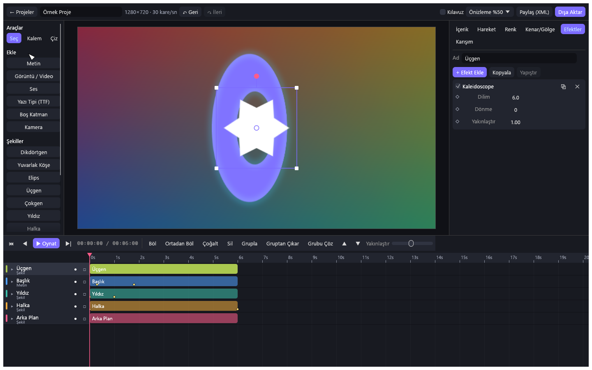
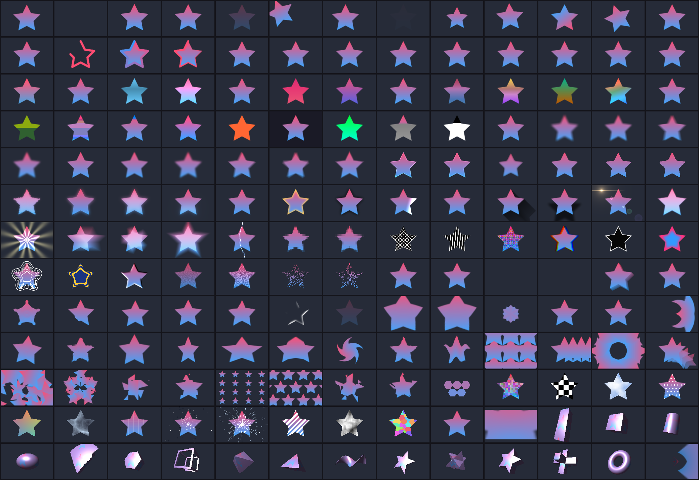

<div align="center">

# CompiMotion

**Windows için tek dosyalık, ücretsiz hareketli grafik ve video düzenleyici.**

169 efekt, keyframe animasyonu, maskeler ve 3B katmanlar. Reklam, filigran, hesap ve abonelik yok.

[](https://github.com/w0rkystudio/CompiMotion/releases/latest)
[](LICENSE)


[**⬇ CompiMotion.exe'yi indir**](https://github.com/w0rkystudio/CompiMotion/releases/latest/download/CompiMotion.exe)



</div>

## Neden CompiMotion?

- **Kurulum yok.** Yaklaşık 21 MB'lık tek bir exe'yi indirip açarsın, yanında başka dosya gerekmez.
- **Her şey açık.** Premium katmanı yok. Bütün efektler baştan kullanılabilir, dışa aktarılan videoya filigran eklenmez.
- **Bilgisayarında kalır.** Uygulama ağa bağlanmaz, hesap istemez, veri göndermez.
- **Paylaşması kolay.** Bir proje; videosu, görselleri, sesi ve eklediğin yazı tipleriyle birlikte tek bir XML dosyası olur.

## Özellikler

### Efektler

Hepsi keyframe ile canlandırılabilen 169 efekt:

| Grup | Örnekler |
| --- | --- |
| Hareket | Auto-Shake, Oscillate, Swing, Spin, Move Along Path, Echo Keyframes |
| Bulanıklık | Gaussian, Lens, Motion, Zoom, Spin, Directional, Unsharp Mask |
| Renk | Color Tune, Hue Shift, Gradient Map, Exposure / Gamma, Posterize, Spot Color |
| Işık ve parıltı | Glow, Edge Glow, Light Glow, Lens Flare, Lightning, Rays |
| Bozulma | Wave Warp, Swirl, Kaleidoscope, Displacement Map, Polar Coordinates, Glass |
| Tekrar | Grid, Radial ve Scatter Repeat, Repeat Along Path, Hexagon Tiling |
| Stil | Halftone, Pixelate, RGB Split, Find Edges, Smooth Bevel, Long Shadow |
| Üretici | Clouds, Turbulence, Voronoi Cells, Starfield, Checker, Stripes |
| 3B şekiller | Cube, Torus, Cylinder, Pyramid, Star Prism, 360º Viewer, Tunnel |
| Metin ve çizgi | Text Transform, Text Progress, Timecode, Count Up/Down, Drawing Progress |
| Maske ve anahtar | Chroma Key, Luma Key, Matte Choker, Roughen Edges, Wipe, Dissolve |

<details>
<summary>Tüm efektlerin varsayılan ayarlarla görünümü</summary>



</details>

### Düzenleme

- **Katmanlar:** şekil, metin, görüntü, video, ses, grup, boş katman ve kamera
- **Animasyon:** her özellik için keyframe, hazır geçişler ve sürüklenebilir bezier eğrisi editörü
- **Kompozisyon:** 31 karışım modu, maske, ters maske, parlaklık maskesi, üst katmana bağlama, hareket bulanıklığı
- **3B:** X/Y dönüşü, derinlik, perspektif ve kamera katmanı
- **Çizim:** 13 hazır şekil, bezier kalem aracı ve serbest çizim
- **Zaman çizelgesi:** kırpma, bölme, gruplama, çoklu seçim ve Ctrl ile uçları birbirine yapıştırma
- **Yazı tipleri:** Windows yazı tiplerinin yanında kendi TTF ve OTF dosyaların
- **Dışa aktarma:** MP4 (H.264 + AAC), GIF, PNG dizisi, tek kare PNG ve saydam arka plan

## Başlarken

1. [CompiMotion.exe](https://github.com/w0rkystudio/CompiMotion/releases/latest/download/CompiMotion.exe) dosyasını indir ve aç.
2. **Örnek Proje** ile hazır bir animasyonu incele ya da **Yeni Proje** oluştur.
3. Soldaki panelden katman ekle veya dosyaları pencereye sürükle.
4. Sağdaki panelden düzenle. Bir özelliğin yanındaki **◇** simgesi o ana keyframe ekler.
5. Sağ üstteki **Dışa Aktar** ile videonu al.

> [!NOTE]
> Exe kod imzalı olmadığı için Windows SmartScreen uyarı gösterebilir. **Ek bilgi → Yine de çalıştır** ile açabilirsin. İstersen indirdiğin dosyayı [sürüm sayfasındaki](https://github.com/w0rkystudio/CompiMotion/releases/latest) SHA-256 değeriyle karşılaştırabilir ya da kaynaktan kendin derleyebilirsin.

## Kısayollar

| Kısayol | İşlem |
| --- | --- |
| `Boşluk` | Oynat / duraklat |
| `←` `→` | Bir kare geri / ileri |
| `Home` `End` | Başa / sona git |
| `Ctrl+Z` `Ctrl+Y` | Geri al / yinele |
| `Ctrl+S` | Kaydet (otomatik kayıt da açıktır) |
| `Shift + tık` | Klip, katman veya keyframe'i seçime ekle / çıkar |
| `Ctrl + sürükle` | Klip uçlarını diğer kliplere yapıştır |
| `Ctrl+C` `Ctrl+V` | Keyframe kopyala / oynatma kafasına yapıştır |
| `Ctrl+D` | Çoğalt |
| `Ctrl+G` | Grupla |
| `S` | Seçili klipleri oynatma kafasında böl |
| `Ctrl+Shift+D` | Seçili klipleri kendi ortasından böl |
| `Delete` | Seçili keyframe'leri, yoksa katmanları sil |
| `V` `P` `B` | Seçim / kalem / serbest çizim aracı |

## Proje paylaşma

Üst çubuktaki **Paylaş (XML)** projeyi tek dosya yapar. Alan kişi giriş ekranından **XML İçe Aktar** ile açar ya da dosyayı pencereye sürükler.

- Medya ve eklediğin yazı tipleri varsayılan olarak dosyaya gömülür, bu yüzden dosya medyadan yaklaşık üçte bir büyük olur.
- Bilgisayarındaki klasör yolları dosyaya yazılmaz.
- İçe aktarılan dosyalar güvenilmez kabul edilir: medya klasörü dışına yazamaz, medya ve yazı tipi olmayan dosyaları açmaz, yerel dosya yollarına erişemez.

Windows'un yazı tipleri klasöründeki yazı tipleri gömülmez. Karşı tarafta bulunmayabilecek bir yazı tipini kendi eklediklerin arasına almak gerekir. Bir yazı tipini paylaşmadan önce lisansının buna izin verdiğine bak.

## Bilinen sınırlar

- **Yalnızca Windows.** Video ve ses, Windows Media Foundation ile işlenir.
- **Efektler işlemcide hesaplanır.** Ağır projelerde önizleme takılabilir; önizleme kalitesini üst çubuktan düşürebilirsin. Örnek proje 720p'de saniyede yaklaşık 4-5 kare hızında dışa aktarılır.
- **Windows N sürümleri** için Medya Özellik Paketi gerekir, yoksa uygulama açılmaz.
- **Medya biçimleri** Windows'un açabildikleriyle sınırlıdır.
- **`.cmproj` proje dosyaları** medyayı yalnızca yol olarak saklar. Başkasına göndermek için XML paylaşımını kullan.
- **Arayüz** şimdilik yalnızca Türkçedir.

Yeni bir proje olduğu için farklı donanımlarda sorun çıkabilir. Sorun yaşarsan `%APPDATA%\CompiMotion\hata.log` dosyası ve bir ekran görüntüsüyle [bildirim aç](https://github.com/w0rkystudio/CompiMotion/issues).

## Kaynaktan derleme

Gerekenler: Windows, [Rust](https://rustup.rs) (kararlı sürüm) ve MSVC derleme araçları.

```bash
git clone https://github.com/w0rkystudio/CompiMotion.git
```

```bash
cargo build --release
```

Çıktı `target/release/CompiMotion.exe` olur. C çalışma zamanı exe'ye gömülüdür.

### Testler

```bash
cargo test
```

Arayüz testleri gerçek arayüz kodunu ekransız çalıştırır, bu yüzden çalışan bir grafik sürücüsü ister. Her biri geçici bir klasör kullanır, gerçek projelerine dokunmaz.

### Komut satırı

```bash
CompiMotion.exe --export demo cikti.mp4 mp4
```

```bash
CompiMotion.exe --contact-sheet efektler.png
```

`--export` bir `.cmproj` yolu ya da `demo` alır; biçim `mp4`, `gif` veya `png` olabilir.

## Mimari

Hepsi `src/` altında:

| Dosya | Görevi |
| --- | --- |
| `model.rs` | Proje, katman, keyframe ve geçiş veri modeli |
| `frame.rs` | Kare, bulanıklık, karışım modları, gürültü |
| `render.rs` | Kompozit motoru: dönüşüm, maske, grup, kamera |
| `vector.rs` | Şekil ve metin çizimi |
| `effects/` | 169 efektin kataloğu ve kodu |
| `media.rs`, `audio.rs`, `export.rs` | Media Foundation ile içe/dışa aktarma, ses karıştırma |
| `xml.rs`, `keys.rs`, `ops.rs` | Paylaşım, keyframe panosu, çoklu seçim ve grup işlemleri |
| `app.rs`, `ui_*.rs` | [egui](https://github.com/emilk/egui) ile arayüz |

Yeni efekt eklemek için `effects/` altındaki bir tabloya bir satır eklemek yeterlidir; parametre arayüzü, keyframe desteği ve testler o tablodan kendiliğinden gelir.

## Katkı

Hata bildirimleri ve pull request'ler açık. Göndermeden önce `cargo test` çalıştırmanı rica ederim.

## Lisans ve yasal not

[MIT](LICENSE) lisansıyla dağıtılır.

CompiMotion, Alight Motion'ın özellik setinden esinlenen bağımsız bir uygulamadır. Tüm kodu sıfırdan yazılmıştır; Alight Motion'ın kodunu veya görsellerini içermez, onunla ya da sahipleriyle bağlantılı değildir ve onlar tarafından desteklenmez. Bu ürünün proje dosyalarını açmaz. Efekt parametreleri ve görünümleri farklılık gösterebilir.
